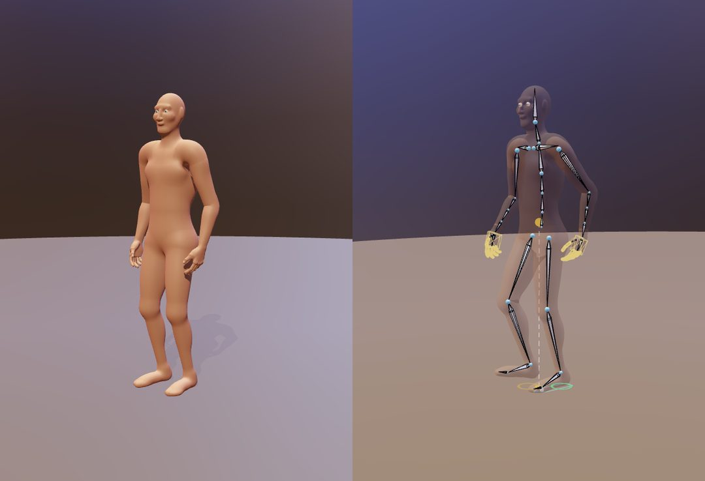
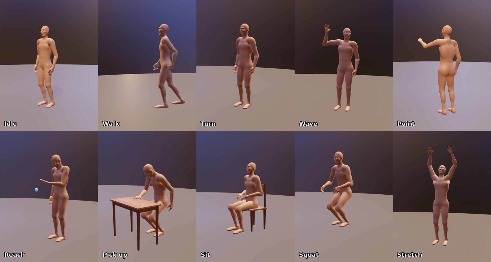
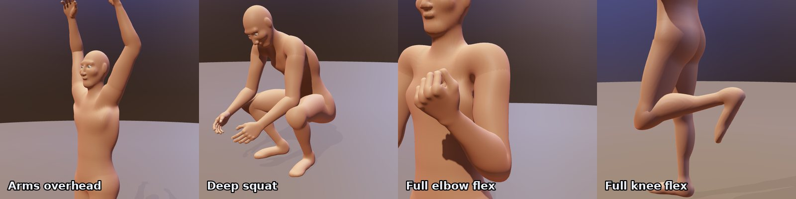
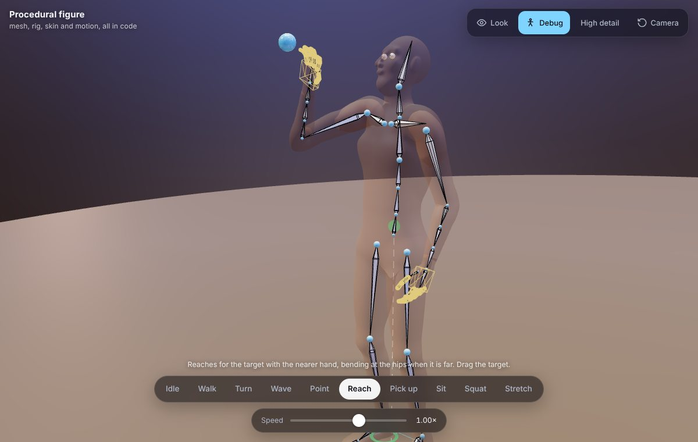
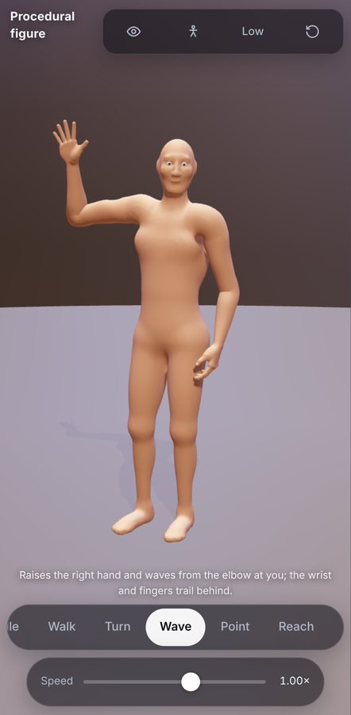

# Procedural figure

A full human figure built entirely in code with three.js: the mesh, the skeleton, the skin weights, the solvers and every movement. There are no model files and no animation clips. Everything lives in one HTML file.



It grew out of a single procedural arm. That arm and hand (38 bones, painted weights, SDF hand, two-bone IK, springs, finger contact solver) are still in the file, unchanged in behaviour, and now run twice: once per side. [NOTES.md](NOTES.md) describes the original arm before the upgrade.

## Run it

Open `index.html` in a browser. It loads three.js and the lighting environment from a CDN, so it needs a connection. The skin is generated at load: about 2.5 s on a desktop at high detail, under 1 s at low detail.

## Controls

| | Desktop | Phone |
|---|---|---|
| Choose a movement | Buttons at the bottom, or keys `1`–`0` | Tap a button (the row scrolls) |
| Speed | Slider (0.4×–1.4×). Sets walking speed and the tempo of the other movements | Same |
| Look at cursor | **Look** button or `L`; the head and eyes follow the mouse | **Look**, then tap where it should look |
| Orbit / zoom / pan | Drag / scroll / right-drag | One finger / pinch / two fingers |
| Reset the camera | **Camera** button or `R` | **Camera** button |
| Debug view | **Debug** button or `D` | Same |
| Mesh detail | **High / Low** button or `Q` (rebuilds the mesh) | Same; phones start on Low |
| Move the target | Drag the blue ball in Reach, Point and Turn | Same |
| Pause | `Space` | – |

Movements: **Idle**, **Walk**, **Turn**, **Wave**, **Point**, **Reach**, **Pick up**, **Sit**, **Squat**, **Stretch**.



## Architecture

The script is split into numbered sections (`§0`–`§14`), each with a header comment.

### Mesh (§2, §4, §6)

- **Arms and hands** are the original rig: a swept tube with a superellipse cross-section and Gaussian muscle bumps, plus a hand built from distance fields (palm, four fingers, thumb), smooth-blended and meshed with surface nets. The left arm builds this geometry once in its own *arm space*; the right arm reuses it through a mirror, with the triangle winding flipped.
- **The body** (torso, pelvis, neck, head, thighs, calves, feet) is one distance field: ellipsoids and tapered capsules joined with a polynomial smooth minimum, so every junction gets a fillet. The shoulder stub *is* the arm tube's own distance field, so the torso blends into exactly the surface the arm starts with. The face has a brow, nose, lips, ears and eye sockets with lids. Separate eyeballs turn to look.
- **Meshing**: surface nets on a regular grid (6.5 mm high, 11.5 mm low). A coarse pass skips cells far from the surface (about 6× fewer evaluations), and a Newton step along the field gradient pulls each vertex onto the surface, removing the faceting of plain surface nets.
- Proportions: 1.76 m tall with a 0.235 m head (7.5 heads), shoulder girdle, ribcage taper, waist, hips and neck.
- One `SkinnedMesh`: 236k triangles at high detail, 78k at low.

### Skeleton (§2, §3): 104 bones

- Body: pelvis, three spine bones, neck, head, two clavicles; per leg a hip half-helper, thigh, two thigh-twist helpers, knee half-helper, shin, foot and toes.
- Each arm: the original 38 bones, plus two upper-arm twist helpers. The arm's `shoulder` root now also turns half of the upper arm's swing.
- Body bones rest unrotated, so their poses are written as world rotations. Each arm root's matrix is written directly from its arm space, which may hold a reflection.

### Skin weights (§5)

- Painted procedurally from the bind-pose position, in the same spirit as the arm. Joints that fold one way get a narrow band on the inside of the bend, where the segments press together along a crease (front of the hip, back of the knee, inside of the elbow), and a wide band on the outside, where the skin stretches.
- Half-angle helpers own the middle of the elbow, knee, hip and every finger joint. The elbow and knee helpers are stretched by the mitre factor `1/cos(θ/2)` so the joint keeps its volume.
- Roll is spread along the forearm (three bones), upper arm (0 / 20% / 60% / 100%) and thigh (25% / 65% / 100%) by twist helpers, using a swing–twist split.
- **Shoulder**: the body and the buried start of the arm tube read the same weight field (torso → clavicle → half-swing shoulder → arm), so where they overlap they move together and the tube stays inside the torso. With the half-swing root and an automatic clavicle shrug, raising the arm does not collapse the shoulder.
- Weights are cross-faded across the midline, so the skin between the legs never tears.
- Muscle bulges are morph targets: biceps and forearm (original), quadriceps (knee bend under load), calves (heel raised, push-off) and breathing (chest and belly).



### Solvers (§3b, §9), in order each frame

1. **Root motion**: walking speed and turn rate. When turning in place, the heading turns toward the wanted direction but never further ahead of the planted feet than the hips can twist.
2. **Feet**: a planted foot never moves. Its pose is a ground point, a heading and a pitch. Pitch > 0 pivots about the heel, pitch < 0 about the ball of the foot with the toes held flat, so the foot rolls heel → flat → toe without its contact sliding (measured drift: 0 mm). Walking uses a gait clock: cadence rises with speed, each foot swings for 38% of the cycle, and the landing point is re-aimed during the swing to where the body will be. Standing, a foot steps when it drifts more than 5 cm or 18° from where the body wants it. Turns lead with the foot on the turning side, and the feet keep at least 15 cm apart.
3. **Pelvis and balance**: the centre of mass (a segment-mass model, from the last frame) is driven over the support polygon (the hull of the planted feet), optionally biased toward one foot for weight shifts. While walking it only sways part of the way. The pelvis is lowered when a planted leg could not otherwise reach its foot. The walking pelvis turns, drops on the swing side and bobs at double support.
4. **Spine**: a wanted chest rotation is spread over three bones: bend mostly low, twist mostly high, side bend evenly. Walking adds counter-rotation against the pelvis.
5. **Head and eyes**: look at a target; the neck takes 40% and the head 60%, within ±70° of yaw and −49°/+37° of pitch. The eyes take what is left. The head's springs are a little underdamped, so it trails and settles.
6. **Clavicles** shrug and come forward when the hand goes high or reaches ahead.
7. **Legs**: analytic two-bone IK with the knee toward the toes, knee range 0–150°, ankle limits, and a correction for the bind pose's slightly non-vertical bones.
8. **Arms**: the original analytic two-bone IK, forearm twist and wrist, plus three robustness additions for a whole body moving through many poses. Hand targets are blended around the shoulder, not through it. The target is kept outside a 30 cm sphere around the joint. The elbow plane is carried between frames and turned toward the pole at a limited rate, so it cannot spin when the pole lines up with the arm.
9. **Hands**: the original finger-capsule contact solver (palm, ball/target, table, thumb against fingers) and behaviour tuning on both hands: two-stage fist, delayed thumb, shared tendons, little-finger-biased relaxed curl.

Every channel runs through a damped spring (wish → spring → solver). The wrist and fingers trail the hand's motion as before. Foot trajectories are not springs: they follow minimum-jerk curves between plants, so planted feet stay exactly still.

### Movement system (§10)

A movement is not a clip. Each frame it writes a *wish*: hand targets and hand shapes, pelvis and spine offsets, stance, balance strength and weight bias, a look target, walking speed and turn. It computes these from phase variables and from where the body actually is. The active movements' wishes are blended with smoothstep-eased weights over 0.9 s. A movement that is mid-way (seated, squatting) first finishes standing up, and only then does the next one fade in. Props (table, chair, ball, target) fade in where a movement needs them. The ball is carried by the palm, or falls and comes to rest on the table or floor.

Checked: switching between all ten movements every 2.5 s in random orders (12 seeds × 30 switches), the fastest any tracked joint moves is 5.5 m/s (a swinging foot in a brisk walk). No frame-to-frame jumps.

### UI (§12–§14)

The debug view shows the skeleton over a translucent skin, the finger contact capsules and palm box, and a ring under each foot (green planted, amber swinging) with its pivot point. It also shows the support polygon and the centre of mass with its ground projection: green over the polygon, amber outside it while walking (normal in single support), red outside it while standing.



The camera's orbit target follows the figure as it walks. On phones the controls have 44 px tap targets and respect the safe areas.



## Performance

- The solvers cost 0.2–0.4 ms per frame on a desktop CPU, for every movement.
- High detail is 236k triangles with a physical skin material and 2048² soft shadows. Low detail is 78k triangles with a standard material, 1024² shadows and the pixel ratio capped at 1.5. Phones (coarse pointer) start on Low.
- Frame rate on a real mid-range phone has not been measured; the numbers above are from a desktop browser. The **Low** setting exists for phones; if it is still slow, the next levers are the shadow map and the pixel ratio.

## Recording the showcase video

The page can render a scripted tour of every movement frame by frame, so it never drops frames.

```bash
node record-server.js
```

Open `http://localhost:5187/`, then run this in the browser console:

```js
await rig.direct()                        // options: { fps: 60, W: 1080, H: 1350, perMove: 7 }
```

Frames are written to `frames/`. Encode them with ffmpeg:

```bash
ffmpeg -framerate 60 -i frames/f_%05d.jpg -c:v libx264 -crf 18 -pix_fmt yuv420p showcase.mp4
```

## Known limitations

- **Seams**: the arm tube meets the body at the shoulder and the hand at the wrist, as two overlapping surfaces with shared weights. A faint line shows close up at both.
- **No body self-collision**: only the fingers collide (with the palm, the other fingers, the ball/target and the table). Arms can pass into the torso or thighs in unusual poses, for example a target dragged behind the body, and thighs and calves overlap at full knee flex.
- **Linear blend skinning**: extreme twists still lose some volume (twist helpers spread it, they do not remove it), and the groin folds sharply in a deep squat.
- **Walking**: the path is a fixed circle (the speed changes, not the route). There is no stepping over obstacles, no running gait, and the arm swing is a target path rather than a pendulum.
- **Pick up**: the ball is attached to the palm while carried (the fingers then wrap it by contact). A movement switched away mid-carry drops it.
- **Sit**: the chair is placed behind the figure when the movement starts, so the figure never walks to a chair.
- **Look**: the head limits are fixed; looking straight behind turns the head to its limit and the eyes to theirs, but not the body (only **Turn** turns the body).
- The face is a stylised mannequin. The skin, eyes and wood are generated in code and are not photographic.
- Phone performance is untested on real hardware (see Performance).
